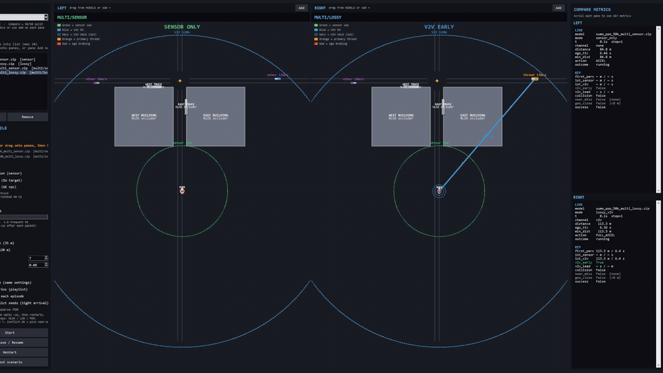
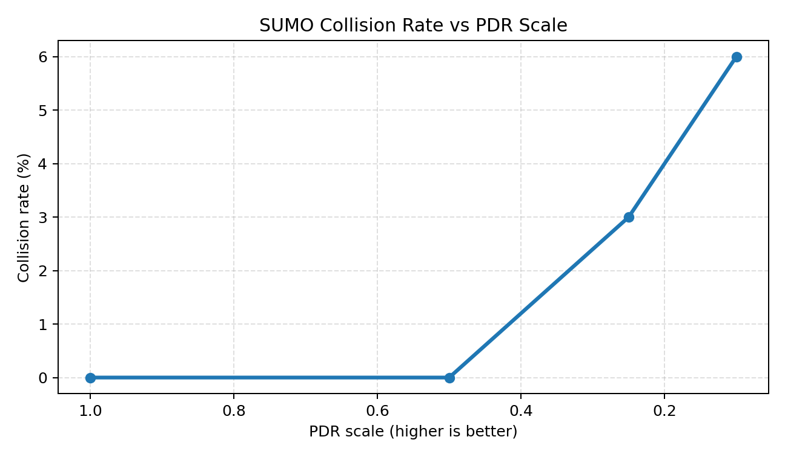

# V2V PPO Rebuild

Blind-intersection에서 **센서만으로는 충돌회피 정책 학습이 어렵지만, V2V 조기 정보로 그 한계를 극복할 수 있다**는 것을 SUMO + PPO로 검증한 졸업작품 저장소입니다.

메인 코드: [`v2v_rebuild/`](v2v_rebuild/)

## Demo

> Sensor는 약 17 m / 0.5 s에야 인지해 충돌률 39–54%인 반면,  
> Lossy V2V는 약 108 m / 6 s에 먼저 인지해 충돌을 0%로 줄인다.

<p align="center">
  
</p>

<p align="center"><em>Compare mode — sensor-only (left) vs lossy V2V (right), NLOS occlusion</em></p>

<p align="center">
  
</p>

<p align="center">
  
</p>

| GUI 데모 | 촬영 가이드 |
| --- | --- |
| [`demo_package/`](v2v_rebuild/demo_package/) → `run_demo.bat` | [`DEMO_RECORDING.md`](v2v_rebuild/DEMO_RECORDING.md) |

## 핵심 결과

출처: [`v2v_rebuild/presentation/테스트지표2/`](v2v_rebuild/presentation/테스트지표2/)  
(시나리오 × 200 episodes, seed 0–199)

| 시나리오 | Collision | Success | V2V early | 최초인지거리 | 최초인지 TTC | V2V lead |
| --- | ---: | ---: | ---: | ---: | ---: | ---: |
| sensor | 39.0% | 61.0% | 0% | 17.0 m | 0.49 s | — |
| multi_sensor | 54.0% | 46.0% | 0% | 16.0 m | 0.52 s | — |
| lossy | **0.0%** | **100%** | **100%** | **108.0 m** | **6.07 s** | **6.2 s / 74 m** |
| multi_lossy | **0.0%** | **100%** | **100%** | **107.2 m** | **5.88 s** | **5.3 s / 66 m** |
| lossy (PDR=0.3) | 0.5% | 99.5% | 100% | 96.8 m | 5.15 s | 5.3 s / 65 m |
| multi_lossy (PDR=0.3) | 4.0% | 96.0% | 100% | 96.0 m | 4.85 s | 4.7 s / 63 m |

상세 해석: [`FINAL_지표요약.md`](v2v_rebuild/presentation/테스트지표2/FINAL_지표요약.md)

## Quickstart

- Python 3.10+ · [Eclipse SUMO](https://eclipse.dev/sumo/) (`SUMO_HOME`)  
- 의존성: [`v2v_rebuild/requirements.txt`](v2v_rebuild/requirements.txt)

```powershell
cd v2v_rebuild
python -m venv .venv
.\.venv\Scripts\Activate.ps1
pip install -r requirements.txt
python sumo_data/build_net.py   # 네트워크가 없을 때

# GUI 데모 (models/ 자동 로드)
cd demo_package
.\install.bat
.\run_demo.bat
```

학습·배치 평가 예시는 [`v2v_rebuild/README.md`](v2v_rebuild/README.md)를 참고하세요.

## 저장소 구조

```text
.
├── README.md              # 이 페이지 (주장 · 데모 · 표)
├── LICENSE                # MIT
├── legacy/                # 초기 통합 환경 (참고 전용, 실행 경로 아님)
└── v2v_rebuild/           # 메인 실험 · 데모 · 최종 지표
    ├── demo_package/      # 독립 GUI
    ├── presentation/      # 그래프 · 테스트지표2 · media/demo.gif
    ├── models/            # 기본 PPO zip
    └── EXPERIMENT_SUMMARY.md  # 단계별 실험 서술
```

## 사용 오픈소스

- [Eclipse SUMO](https://github.com/eclipse-sumo/sumo) / TraCI
- [Gymnasium](https://github.com/Farama-Foundation/Gymnasium)
- [Stable-Baselines3](https://github.com/DLR-RM/stable-baselines3)

## License

MIT — see [`LICENSE`](LICENSE).
