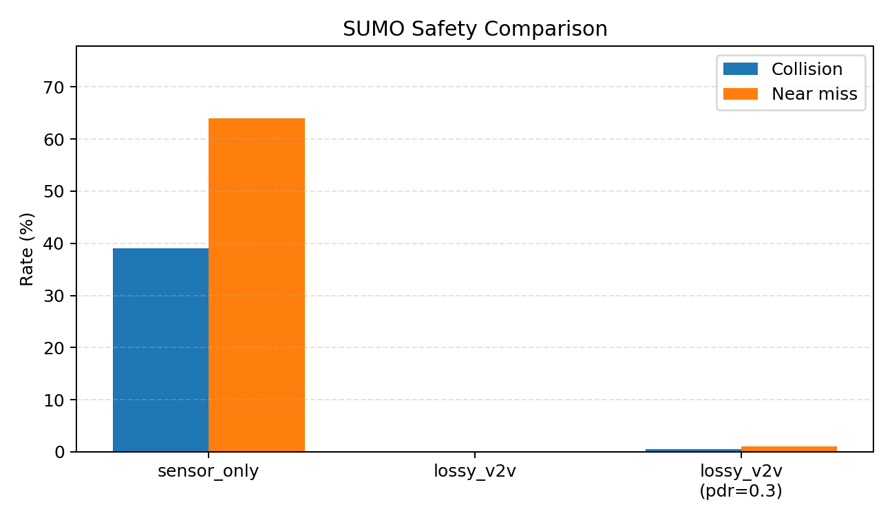

# V2V PPO Rebuild

Blind-intersection에서 **센서만으로는 충돌회피 정책 학습이 어렵지만, V2V 조기 정보로 그 한계를 극복할 수 있다**는 것을 PPO ablation으로 검증한 졸업작품 재구성 저장소입니다.

메인 코드: [`v2v_rebuild/`](v2v_rebuild/)

## Demo

> Sensor는 약 17 m / 0.5 s에야 인지해 충돌률 39–54%인 반면,  
> Lossy V2V는 약 108 m / 6 s에 먼저 인지해 충돌을 0%로 줄인다.

<p align="center">
  
</p>

<p align="center"><em>Compare mode — sensor-only (left) vs lossy V2V (right), NLOS occlusion</em></p>

<p align="center">
  
</p>

<p align="center">
  
</p>

| 로컬 GUI | 영상 촬영 |
| --- | --- |
| [`demo_package/`](v2v_rebuild/demo_package/) → `run_demo.bat` | [`DEMO_RECORDING.md`](v2v_rebuild/DEMO_RECORDING.md) |

## 핵심 결과 (최종 지표)

출처: [`v2v_rebuild/presentation/테스트지표2/`](v2v_rebuild/presentation/테스트지표2/)  
프로토콜: 6시나리오 × 200 episodes (동일 seed 0–199, perfect 제외, PDR 0.3 포함)

| 시나리오 | Collision | Success | V2V early | 최초인지거리 | 최초인지 TTC | V2V lead |
| --- | ---: | ---: | ---: | ---: | ---: | ---: |
| sensor | 39.0% | 61.0% | 0% | 17.0 m | 0.49 s | — |
| multi_sensor | 54.0% | 46.0% | 0% | 16.0 m | 0.52 s | — |
| lossy | **0.0%** | **100%** | **100%** | **108.0 m** | **6.07 s** | **6.2 s / 74 m** |
| multi_lossy | **0.0%** | **100%** | **100%** | **107.2 m** | **5.88 s** | **5.3 s / 66 m** |
| lossy (PDR=0.3) | 0.5% | 99.5% | 100% | 96.8 m | 5.15 s | 5.3 s / 65 m |
| multi_lossy (PDR=0.3) | 4.0% | 96.0% | 100% | 96.0 m | 4.85 s | 4.7 s / 63 m |

요약: [`FINAL_지표요약.md`](v2v_rebuild/presentation/테스트지표2/FINAL_지표요약.md)

## Quickstart

### 요구사항

- Python 3.10+ 권장
- [Eclipse SUMO](https://eclipse.dev/sumo/) (TraCI) — `SUMO_HOME` 설정
- 의존성: [`v2v_rebuild/requirements.txt`](v2v_rebuild/requirements.txt)

```powershell
cd v2v_rebuild
python -m venv .venv
.\.venv\Scripts\Activate.ps1
pip install -r requirements.txt
```

네트워크가 없다면:

```powershell
python sumo_data/build_net.py
```

### 학습 / 평가 예시

```powershell
# SUMO PPO 학습 (lossy V2V)
python train_sumo_ppo.py --mode lossy_v2v --timesteps 50000 --out runs/sumo_ppo_50k_lossy.zip

# 평가
python evaluate_sumo.py --model runs/sumo_ppo_50k_lossy.zip --mode lossy_v2v --episodes 100

# 최종 지표 스타일 평가 (6시나리오 배치)
python run_metric_eval.py --episodes 200 --out-dir presentation/테스트지표_local
```

### GUI 데모

```powershell
cd demo_package
.\install.bat    # 최초 1회
.\run_demo.bat
```

모델 zip은 GUI에서 Add. 상세: [`demo_package/README.md`](v2v_rebuild/demo_package/README.md)

## 저장소 구조

```text
.
├── README.md                 # 공개 랜딩 (주장 → 데모 → 표)
├── LICENSE                   # MIT
├── legacy/                   # 초기 통합 환경 (참고용)
└── v2v_rebuild/              # 메인 프로젝트
    ├── DEMO_RECORDING.md     # 데모 영상 촬영 가이드
    ├── run_metric_eval.py
    ├── sumo_data/
    ├── runs/
    ├── presentation/         # 그래프 · 최종 지표 · media/
    └── demo_package/         # 독립 실행 데모
```

## 실험 단계 (요약)

1. **Stage 1** — kinematic blind-intersection + PPO sanity check  
2. **Stage 2** — `sensor_only` vs `perfect_v2v`  
3. **Stage 3** — `lossy_v2v` + PDR/AoI sweep  
4. **Stage 4** — SUMO(TraCI) 이식 + 기상/NLOS/multi-NPC 확장  

상세: [`v2v_rebuild/README.md`](v2v_rebuild/README.md) · [`EXPERIMENT_SUMMARY.md`](v2v_rebuild/EXPERIMENT_SUMMARY.md)

## 직접 사용한 오픈소스

- [Eclipse SUMO](https://github.com/eclipse-sumo/sumo) / TraCI
- [Gymnasium](https://github.com/Farama-Foundation/Gymnasium)
- [Stable-Baselines3](https://github.com/DLR-RM/stable-baselines3)

## 참고한 관련 프로젝트 (코드 미통합)

- [V2V Cooperative Intersection RL](https://huggingface.co/amin-amiri/v2v-intersection-rl)
- [SUMO-V2X Communication Research](https://github.com/sraddon/SUMO-V2X-Communication-Research-Platooning-and-CIM)
- [V2V-GoT](https://github.com/eddyhkchiu/V2V-GoT)

## License

MIT — see [`LICENSE`](LICENSE).
